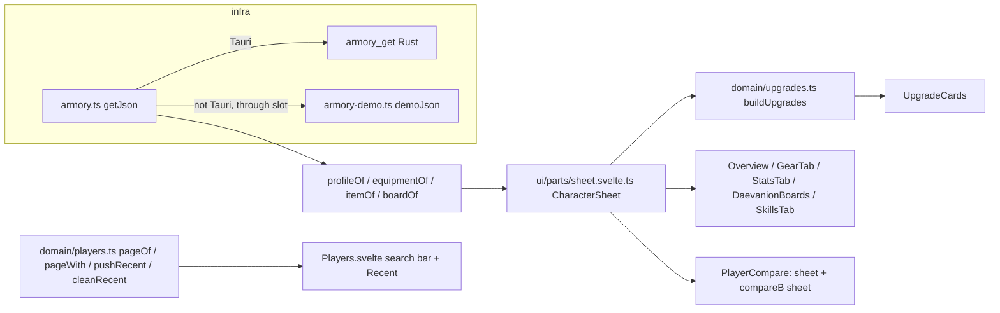

# Players page redesign: design

Status: building · Plan: players-redesign.plan.md · Designed: 2026-11-27

## Overview
Work on a branch off `beta` (Best upgrades lives only there; rebase on `beta` before each feature). One reactive `CharacterSheet`
per opened character loads the profile (with today's 25 s `within()` timeout), equipment, every piece's details and the Daevanion boards once;
every tab reads from it. The upgrade plans move out of `Equipment.svelte` into a pure, tested `domain/upgrades.ts` early (F3), so each
feature stays usable on its own: today's `UpgradeCards` is mounted in the Upgrades tab from F3 and only redesigned in F7.
Outside Tauri, the armory adapter answers each official URL with site-shaped demo JSON (the real parsers run), matching the browser's
demo meter profile "Demo Alt" (server 1304, `infra/meter.ts:172`), so every tab, "your character" cases included, can be checked in the browser pane.



## Decisions
### ADR-1. Where the plan building lives
- Options: pure domain function · moved as is into the UI loader
- Chosen: `domain/upgrades.ts` `buildUpgrades` (the player's pick) — tested with `npm test`; the UI passes the bundled JSON tables in, domain imports no assets.
- Consequences: `Equipment.svelte`'s plan code (beta `:49-79`) is moved, not copied; tests pass tables as literals (node `--test` can't take Vite JSON imports; no test imports JSON today).

### ADR-2. One loader for every tab and both Compare sides
- Options: a shared `CharacterSheet` class · keep `Equipment.svelte` / `PlayerCompare.svelte` / Players' `show()` loading on their own
- Chosen: `CharacterSheet` (the player's pick). Players' `profile` / `loading` / `profileError` and the `equipmentOf` prefetch in `show()` are deleted: the header reads `sheet.*`; Compare = `sheet` + `compareB` sheet.
- Consequences: "Try again" = a new sheet for the same character; `PlayerCompare`'s `Side` / `load` go away.

### ADR-3. Demo data level
- Options: raw site JSON in `getJson` · parsed objects
- Chosen: raw site JSON (the player's pick), through the request queue (`slot()`, 150 ms apart) so "Reading the pieces… n / N" is visible as in the app.
- Consequences: the fixture is written from the parsers' field names in `domain/armory.ts`; search URLs for the other servers of the region answer an empty, site-shaped list (else `searchRegion` reports 11 servers failing).

### ADR-4. Compare's second side and "Other"
- Options: picking mode reusing the search bar · a separate search inside the Compare tab
- Chosen: picking mode. While `pickingCompare`: `search()` leaves `open` and `sheet` alone, the results unfold with the hint "Pick the character to compare with" + Cancel; `show(c)` then sets `compareB = new CharacterSheet(c)`, leaves picking mode, and does not replace the opened sheet. Swap is a local flag inside `PlayerCompare` (the header and other tabs keep the opened character).
- Consequences: `show()` (a normal open) disposes `compareB` unless it came from "Other"; it is recomputed as "your character" when the Compare tab opens, never when the opened character is yours.

## Data model
- No `AppData` change, no migration, nothing exported or uploaded.
- localStorage `aion2-players-recent`: `Found[]` JSON, at most 5 (per-viewer convenience; try/catch, empty on failure).
- Removed state: `Equipment.svelte` (whole file, F4), Players' `profile` / `loading` / `profileError` / `first` / `comparing`; new `sheet`, `compareB`, `compareFromOther`, `pickingCompare`, `tab`, `page`, `resultsOpen`.

## Shared

**Interfaces**
```ts
// src/ui/parts/sheet.svelte.ts (UI layer, runes)
export class CharacterSheet {
  constructor(found: Found, className?: string);
  readonly found: Found;
  profile: Profile | null;                     // $state
  eq: Equipment | null;                        // $state
  details: Record<number, ItemDetail | null>;  // by Piece.slot; absent = not read yet
  errors: Record<number, string>;              // piece read failures by slot
  boards: Record<number, Board | null>;        // by board id
  loading: boolean; error: string;             // profile (within 25 s) and equipment read state
  readonly all: Piece[];                       // $derived gear + accessories + arcana
  readonly reading: { read: number; total: number } | null; // null once every piece is read or failed
  readonly upgrades: Upgrades;                 // $derived buildUpgrades(eq, details, className, tables with ui.data.bis)
  readonly bisCount: { has: number; total: number }; // checkBis over every piece with ideal lines
  readonly toImprove: number;                  // upgrades.todo.length + arcana with missing or wasted skills
  load(): void;                                // starts every request once; idempotent
  dispose(): void;                             // later answers dropped
}

// src/ui/icons.ts (additions)
export const STAT_ICON: Record<string, Component>;
export const statIcon: (name: string) => Component;        // case-insensitive, " Bonus"/" Increase" ignored, else Sparkle
export const SLOT_ICON: Record<string, Component>;         // bisSlot names (Weapon, Torso, Pants, …, Arcana1-5)
export const slotIcon: (slot: string | null) => Component; // else Shirt
```
```svelte
<!-- src/lib/components/app/UnderlineTabs.svelte: one item type; today's 2-tuples (Arena, Crafting, Dps, Fights) still fit -->
items: readonly (readonly [T, string, Component?, (string | number)?])[]
```

## Features

### F1. Demo profile outside Tauri
**Interfaces**
```ts
// src/infra/armory-demo.ts — imports only domain/armory.ts and domain/servers.ts; never infra/armory.ts or @tauri-apps/*
export const DEMO_SERVER = 1304;      // the browser's demo meter profile's server (infra/meter.ts:172)
export const DEMO_NAMES = ["Demo Alt", "Demora", "Demo Broken"] as const;
export function demoJson(url: string): unknown;
// search URL on DEMO_SERVER → the demo names + "Demo 1"…"Demo 7" (search only) containing the text; on another server → an empty site-shaped answer;
// info / equipment / item / daevanion of Demo Alt and Demora → site-shaped JSON (Demora: fewer pieces, lower enchants);
// Demo Broken's info URL and any unknown URL → throws "no demo answer"
// src/infra/armory.ts getJson: `if (!isTauri()) { const done = await slot(first); try { return demoJson(url); } finally { done(); } }`
```
Demo Alt's pieces: a weapon whose lines need rerolls, an already ideal ring, a non-random belt, a bracelet, a Unique arcana with a missing skill, a stat no icon maps.

**Errors & edge cases:** unknown URL → the normal failure path · in Tauri the branch is never taken · the page opens Demo Alt by itself (`openMe` from the demo meter profile), as the desktop app opens your character.
**Tests** (EARS → test):
- WHILE outside Tauri … demo character, "Demo" label → `src/infra/armory-demo.test.ts` "demo JSON parses" (`parseSearch` / `parseInfo` / `parseEquipment` / `parseItem` / `parseBoard` non-null), "other servers answer an empty search", "Demo Broken's info throws"; browser pane: Players opens Demo Alt with the Demo badge
- WHILE in Tauri … never demo data → the `isTauri()` branch in `getJson` (review); `npm test` green

**Tasks**
- [x] **T1.1** Fixture + tests — files: `src/infra/armory-demo.ts`, `src/infra/armory-demo.test.ts` — proves: the three cases above
- [x] **T1.2** `getJson` answers from the demo outside Tauri through `slot()`; "Demo" `Badge` near the profile name when `!isTauri()` — files: `src/infra/armory.ts`, `src/ui/pages/Players.svelte` — proves: browser pane

### F2. Search bar, paged results, Recent
**Interfaces**
```ts
// src/domain/players.ts
export const PAGE_SIZE = 6;
export const RECENT_MAX = 5;
export function pageOf<T>(list: T[], page: number, size?: number): { items: T[]; page: number; pages: number; from: number; to: number }; // page clamped; from/to 1-based, 0/0 when empty
export function pageWith<T>(list: T[], hit: (x: T) => boolean, size?: number): number; // the first hit's page, else 0
export const sameCharacter: (a: Pick<Found, "characterId" | "serverId">, b: Pick<Found, "characterId" | "serverId">) => boolean; // never ===: $state proxies
export function pushRecent(list: Found[], c: Found, max?: number): Found[]; // c first, same characterId + server removed, cut to max
export function cleanRecent(raw: unknown): Found[]; // localStorage JSON → well-formed Found entries only, max RECENT_MAX
```
UI (`Players.svelte`): row 1 `Input` with a search icon, `NativeSelect` region, `Button` Search, `Button` outline with your character's name (`openMe`); row 2 a ghost `Button` "N results for 'X'" + chevron (`resultsOpen`), the servers line (`progress`) + Again, Recent chips (`Button` size sm outline; a chip → `touched = true; region = regionOf(c.serverId); show(c)`); results grid (`grid-cols-[repeat(auto-fill,minmax(240px,1fr))]`), each a ghost `Button` with class icon, name, class · server, level; pager (‹ › icon buttons, "from–to of N"); "Also names containing it" kept. `search()` and the toggle set `page = 0`; `show()` sets `resultsOpen = false` and `recent = pushRecent(...)` (saved).

**Errors & edge cases:** no profile open → results open · toggle opened → `page = pageWith(listed, (c) => sameCharacter(c, open))` · localStorage throws → `[]` · a Recent character renamed or gone → its profile read fails with Try again (no search).
**Tests** (EARS → test):
- WHEN a new search starts or "Also names containing it" changes → page 1 → browser pane (`page = 0` in both handlers)
- WHEN the toggle is pressed … the page holding the open character → `src/domain/players.test.ts` "pageWith finds the hit's page" (with a copy of the hit, not the same object) + "pageOf clamps"; browser pane
- WHEN a character is opened … Recent first, no duplicates, max 5 → `players.test.ts` "pushRecent dedupes and caps"
- IF localStorage is not available … → `players.test.ts` "cleanRecent drops bad entries"; browser pane with storage blocked
- WHEN a profile opens THE results SHALL fold; THE search SHALL behave as today → browser pane (Demo Alt auto-opens; "Demo" lists 10 names over two pages: the search fixture adds 7 search-only names "Demo 1"…"Demo 7", whose profiles fail like Demo Broken)

**Tasks**
- [x] **T2.1** `players.ts` + tests — files: `src/domain/players.ts`, `src/domain/players.test.ts` — proves: the cases above
- [x] **T2.2** Search bar, status line, folded/paged results, Recent — files: `src/ui/pages/Players.svelte` — proves: browser pane

### F3. Profile header, tabs, shared loader
**Interfaces**
```ts
// src/domain/upgrades.ts
import type { Equipment, ItemDetail, Piece } from "./armory.ts";
import type { BisLine, BisTable } from "./bis.ts";
import type { PiecePlan, RankFile, RankedLine, Worth } from "./reroll.ts";
import type { ArcanaPlan, SkillTotals } from "./arcana.ts";
export interface Tables { bis: BisTable; mine: BisTable; carry: Record<string, Record<string, Record<string, number>>>; ranks: RankFile }
export interface GearPlan { p: Piece; plan: PiecePlan; ideal: Worth[]; lines: string[]; ranked: Record<string, RankedLine> | null }
export interface ArcanaItem { p: Piece; slot: string; held: { name: string; level: number | null }[]; plan: ArcanaPlan; ideal: BisLine[] }
export interface Upgrades { plans: GearPlan[]; todo: GearPlan[]; done: GearPlan[]; arcana: ArcanaItem[]; notUnique: string[]; totals: SkillTotals }
export function buildUpgrades(eq: Equipment | null, details: Record<number, ItemDetail | null>, className: string, t: Tables): Upgrades;
// = beta Equipment.svelte :49-79, unchanged (STAT_NAMES = statNamesOf(t.carry)); todo/done split as UpgradeCards does today
```
```ts
// Players.svelte
type TabId = "overview" | "gear" | "upgrades" | "stats" | "dae" | "skills" | "compare";
const tabs = $derived([["overview", "Overview", ICON…], ["gear", "Gear", …], ["upgrades", "Upgrades", …, sheet?.reading ? undefined : sheet?.toImprove || undefined], …]);
let tab = $state<TabId>("overview");          // "overview" on every show()
let sheet = $state<CharacterSheet | null>(null); // new in show(), the old one disposed; also disposed on unmount
```
Header (profile `Panel`): class icon, name, class · server · level, Demo badge, `Button` Compare (→ tab compare), icon `Button` official profile, shugo.gg link; four `Kpi` tiles: Combat power, Item level, BiS lines (`bisCount`), Daevanion (Σ `profile.boards` open / total). Until F4/F7 the tabs not built yet show today's parts: Gear = today's `Equipment` (beta), Upgrades = today's `UpgradeCards` fed from `sheet.upgrades`, Stats / Daevanion / Skills = today's blocks.

**Errors & edge cases:** reading → "Reading the profile…"; error → message + Try again (new sheet); tabs hidden until a profile · piece errors stay on their cards · switching tabs never re-requests.
**Tests** (EARS → test):
- WHEN a profile opens THE page SHALL show Overview → browser pane
- WHILE reading / failed read + Try again → browser pane: open "Demo Broken"
- THE equipment and each piece requested once per opened character → `CharacterSheet.load()` idempotent (guard flag) + the infra cache (`kept`, 10 min); browser pane: switch every tab, no "Reading…" again
- THE tab bar SHALL fit ~830 px and scroll sideways → browser pane at 1440 px with the inspector, then 1100 px
- (moved logic) → `src/domain/upgrades.test.ts` "buildUpgrades matches the old Equipment logic" (fixture tables as literals: a weapon needing rerolls, an ideal ring, a Unique arcana, a non-random belt skipped) and "everything ideal: todo empty, done full"

**Tasks**
- [x] **T3.1** `buildUpgrades` + tests — files: `src/domain/upgrades.ts`, `src/domain/upgrades.test.ts` — proves: the two cases
- [x] **T3.2** `UnderlineTabs` optional icon + badge — files: `src/lib/components/app/UnderlineTabs.svelte` — proves: `npm run check`; DPS Log / Settings / Arena tabs unchanged in the browser pane
- [x] **T3.3** `STAT_ICON` / `SLOT_ICON` — files: `src/ui/icons.ts` — proves: `npm run check`
- [ ] **T3.4** `CharacterSheet` (with `upgrades` from `buildUpgrades` + bundled `bis.json`, `carry.json`, `ranks.json`) — files: `src/ui/parts/sheet.svelte.ts` — proves: `npm run check`; browser pane
- [ ] **T3.5** Header + tabs in `Players.svelte` on the sheet; Players' own profile state and prefetch removed; Upgrades tab = today's `UpgradeCards` (+ `UpgradeInfo` toggle) from `sheet.upgrades`; `Equipment.svelte` reads the sheet (props `sheet`) instead of loading — files: `src/ui/pages/Players.svelte`, `src/ui/parts/Equipment.svelte` — proves: browser pane

### F4. Overview, Gear, Stats, Daevanion tabs
**Interfaces**
```svelte
<!-- src/ui/parts/Overview.svelte --> let { sheet }: { sheet: CharacterSheet } = $props(); <!-- piece grid (item icon, slot, enchant, ideal bar), pet, wings, key stats with statIcon -->
<!-- src/ui/parts/GearTab.svelte -->  let { sheet }: { sheet: CharacterSheet } = $props(); <!-- today's GearCard grids + BiS source line -->
<!-- src/ui/parts/StatsTab.svelte --> let { sheet }: { sheet: CharacterSheet } = $props(); <!-- official stats Table with icons + "Stats from gear" -->
<!-- src/ui/parts/DaevanionBoards.svelte --> props: { boards: Profile["boards"]; read: Record<number, Board | null> } (its own $effect and boardOf removed: Players is its only caller) -->
```
`Equipment.svelte` is deleted at the end of F4 (its parts now GearTab / StatsTab / Overview; skills move in F5, so F4 keeps a temporary skills block in Players until T5.1).

**Errors & edge cases:** unmapped stat → `statIcon` fallback · a piece not read yet → today's card state · no arcana → today's hint · no boards → "No Daevanion board read".
**Tests** (EARS → test):
- THE Gear tab SHALL keep BiS flip and own lists → browser pane: flip, Edit, save, reload
- THE Stats tab SHALL show every stat with effects + Stats from gear shares → browser pane
- IF no icon … generic → browser pane (Demo Alt's unmapped stat)
- `design.test.ts`, `npm run check` green

**Tasks**
- [ ] **T4.1** GearTab — files: `src/ui/parts/GearTab.svelte`, `Players.svelte` — proves: browser pane
- [ ] **T4.2** StatsTab — files: `src/ui/parts/StatsTab.svelte`, `Players.svelte` — proves: browser pane
- [ ] **T4.3** Overview — files: `src/ui/parts/Overview.svelte`, `Players.svelte` — proves: browser pane
- [ ] **T4.4** DaevanionBoards on the sheet's boards; `Equipment.svelte` deleted (skills block kept in Players until T5.1) — files: `src/ui/parts/DaevanionBoards.svelte`, `src/ui/parts/Equipment.svelte`, `Players.svelte` — proves: browser pane, `npm run check`

### F5. Skills tab
**Interfaces**
```svelte
<!-- src/ui/parts/SkillsTab.svelte --> let { sheet, genus, mine }: { sheet: CharacterSheet; genus: GenusRead | null; mine: boolean } = $props();
```
Active / Passive / Stigma grids (today's `eq-skill` look, a Lucide lock instead of the 🔒 emoji, "E" for equipped stigma), then `GenusInsight` when `genus`, else today's hint when `mine`, else nothing.

**Errors & edge cases:** no skills → "No skills on the official profile" · Genus lookup case-insensitive as today.
**Tests** (EARS → test):
- WHILE yours with Genus → browser pane: a `GenusRead` under "Demo Alt" in `ui.data.genus` (localStorage `aion2-companion-data`)
- WHILE yours without Genus → hint → browser pane on Demo Alt (it is "you": the demo meter profile)
- WHILE someone else's → skills only → browser pane on Demora

**Tasks**
- [ ] **T5.1** SkillsTab; the temporary skills block removed — files: `src/ui/parts/SkillsTab.svelte`, `Players.svelte` — proves: browser pane

### F6. Compare tab, slot by slot
**Interfaces**
```svelte
<!-- src/ui/parts/PlayerCompare.svelte (rewritten) -->
let { a, b, onother }: { a: CharacterSheet; b: CharacterSheet | null; onother: () => void } = $props();
let swapped = $state(false); // local: the header and other tabs keep the opened character
```
Rows over existing helpers, no new domain code: profile numbers (`profileRows`), slots (`slotPairs` order = slot position; per row `slotIcon(bisSlot(...))`, `slotLabel`, each side's item icon + `pieceText`, ideal count from `checkBis`, Δ = `pieceLevel(a) - pieceLevel(b)` with today's `tone`), pet, wings, boards (`boardRows`), skills (`skillRows`), Genus (`genusRows`, both yours) as today. Players: when the Compare tab opens, `compareB ??= mine && !isMe(open) ? new CharacterSheet(pickFound(await searchPlayers(me…))) : null` (today's `compareWithMe`); "Other" → `pickingCompare = true` (ADR-4); a normal `show()` disposes `compareB` unless `compareFromOther`.

**Errors & edge cases:** your character unknown or the opened one is yours → "Pick a character to compare with" + Other · side B fails → its column shows the error + Try again · empty slot → "—" (`pieceText(null)`) · Swap → columns swap, no re-read.
**Tests** (EARS → test):
- THE Δ green / red / neutral; IF a slot is empty … "—" → existing `compare.test.ts` cases for `slotPairs`, `pieceLevel`, `pieceText` (add one for an empty side if missing); browser pane
- WHEN the Compare tab opens on someone else … your character → browser pane: open Demora, Compare → side B = Demo Alt
- WHEN the open character is yours … ask for another → browser pane on Demo Alt
- WHEN Other … compare against it, keep the opened profile → browser pane: on Demo Alt, Other, search "Demora", click → Demo Alt vs Demora, header still Demo Alt

**Tasks**
- [ ] **T6.1** PlayerCompare rewritten on two sheets, rows layout, local Swap — files: `src/ui/parts/PlayerCompare.svelte`, `src/domain/compare.test.ts` (empty-side case if missing) — proves: `npm test`, `npm run check`, browser pane
- [ ] **T6.2** Compare tab wiring: default side B, Other picking mode (search keeps `open`/`sheet`), `compareB` lifecycle — files: `src/ui/pages/Players.svelte` — proves: browser pane

### F7. Upgrades tab redesign
**Interfaces**
```svelte
<!-- src/ui/parts/UpgradeCards.svelte (rewritten) -->
let { up, reading, className, players, source, ranks }: { up: Upgrades; reading: { read: number; total: number } | null; className: string; players: number;
  source: { source: string; sourceUrl: string; captured: string }; ranks?: { tiers: Record<string, number>; source: string; captured: string } } = $props();
let opened = $state<string | null>(null); // "g:<slot>" | "a:<slot>"; the first todo row open at start
<!-- UpgradeInfo keeps its props, fed as today: example = up.plans.find((x) => x.plan.steps.length) ?? null, ranked = up.plans.some((x) => x.ranked) -->
```
Summary line (to improve = `sheet.toImprove` of total pieces, ≈ tries for all = Σ `ceil(plan.tries)` over `todo`, "How it's scored" toggling `UpgradeInfo`); gear rows (rank, item icon + enchant, name, "Up next" on the first, now/after bar, slot · now → ≈after / 100 · ≈tries, +gain, chevron) opening in place with today's steps, tier chips, Philosopher's Stone, reset, unobtainable texts; Arcana section, same row header (kind, have/wanted, craft or farm), opening today's Transmute options / farm advice / wasted levels / not-unique note; Already ideal (gear `done`, arcana done, skills done) as item icons with names in `title`. Every text and number today's UpgradeCards shows stays.

**Errors & edge cases:** reading → "Reading the pieces… n / N", known rows shown · nothing to do → today's message + Already ideal · reopened character → `opened` = the first todo · bracelet and unobtainable texts kept.
**Tests** (EARS → test):
- THE queue SHALL hold everything UpgradeCards shows today → `upgrades.test.ts` (T3.1) pins the data; browser pane side by side with the F3 version (today's cards) before replacing it
- WHEN a row is pressed … opens; again … closes → browser pane
- WHILE pieces are still being read … n / N → browser pane (demo answers go through `slot()`, 150 ms apart)
- IF nothing is left … → `upgrades.test.ts` "everything ideal"; browser pane
- THE layout SHALL be one column → browser pane at 1440 px with and without the inspector
- `reroll.test.ts`, `arcana.test.ts` green

**Tasks**
- [ ] **T7.1** UpgradeCards rewritten as the queue; Upgrades tab badge = `toImprove` — files: `src/ui/parts/UpgradeCards.svelte`, `src/ui/pages/Players.svelte` — proves: browser pane
- [ ] **T7.2** Styles no longer referenced removed (old `.ups` / `.up` rules, `eq-*` rules moved or dropped) — files: `src/ui/parts/UpgradeCards.svelte`, `src/style.css` — proves: `npm run check`, `npm test` (`design.test.ts`)

### F8. Docs
**Tasks**
- [ ] **T8.1** CLAUDE.md: Players entries (tabs, sheet, `upgrades.ts`, `players.ts`, demo, Recent), the `reroll.ts` entry's UI part — files: `CLAUDE.md` — proves: review

## Risks
- Demo fixture drifts from the site → written from the parsers, `armory-demo.test.ts` runs them; real answers checked in `npm run tauri dev`.
- Moving the plan logic changes a result → `upgrades.test.ts` pins it in F3, before any layout change.
- Beta moves daily (Best upgrades commits) → rebase before each feature; T3.1 moves the logic from the newest `beta`.
- 7 tabs in ~830 px → short labels, `overflow-x-auto` in `UnderlineTabs`.
- A sheet answering after another opened → `dispose()` in `show()` and on unmount.
- `$state` proxies make `===` on characters false → `sameCharacter` everywhere a character is matched.

## Plan changes
None to features or criteria. Design-level choices made in review: the Upgrades badge counts gear and arcana to improve; Recent keeps whole search results so a chip opens the profile directly.

## Open questions
None.
