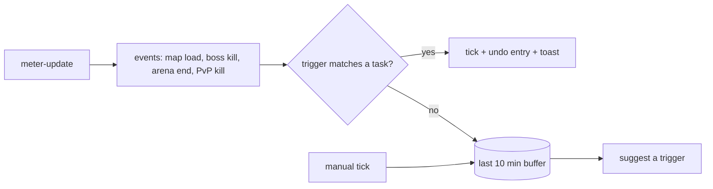

# Three big features for AION 2 Companion

Second pass (2026-10-30), aiming bigger. The meter already sees fights with full skill breakdowns, maps entered,
boss kills, arena matches, PvP kills, currencies, soul points and cubes. **Almost all of it is shown once and forgotten.**
Each feature below turns that stream into something lasting. None needs a new dependency, and all three stay within
the ToS rules (passive traffic copy only).

| # | Feature | What it changes for you | Size |
|---|---------|-------------------------|------|
| 1 | **Fight Log & Parses** | Every boss fight is kept: history, personal bests, run-vs-run skill comparison | L |
| 2 | **Auto-tracked tasks** | The tracker ticks dungeons / arena / bosses itself from what the meter sees | L |
| 3 | **Play Journal** | A timeline of each session plus a weekly recap: where you went, what you earned, what you killed | M–L (on top of 1) |

---

## 1. Fight Log & Parses

**Today:** `meter-update` carries a full `Fight` (target boss, battle time, every player's DPS, crit rate, per-skill damage and hits) every 200 ms. When the fight resets (`dpsIdleSeconds`) it's gone.

**Feature**
- **Fights page (new tab next to DPS).** A list of past fights: boss, map, date, duration, your DPS, party composition by class colour. Filter by boss / map / character.
- **Personal bests per boss.** Best DPS, fastest kill, with a trend sparkline of your DPS on that boss over time (plus gear score / combat power at the time, from `Profile`).
- **Compare two runs.** Pick two fights of the same boss to get a side-by-side skill table: share, hits, crit rate and Δ. It answers "why was today's run 15 % worse?" (e.g. fewer casts of skill X, lower crit).
- **Open a past fight in the normal DPS view.** It reuses `Dps.svelte` with a saved `Fight` instead of the live one.

**How**
- `src/domain/fights.ts` (pure): `fightEnded(prev, next)`, which detects the end when battle time goes back to 0 or the target changes with the boss dead or the fight idle. `toRecord(fight, profile, mapId, now)` keeps only what's needed. It drops `icon` and keeps your own skills plus each player's top-N to bound the size. `personalBests`, `compare(a, b)`.
- **Storage outside the save file.** Fights can be hundreds of KB, and `data.json` is the export format. They go in a separate plugin-store file `fights.json` (same plugin, no new dep), in `src/infra/fights.ts`. Rolling cap (e.g. last 500 fights + every personal best kept forever).
- Only boss targets (`target.isBoss`) and arena fights are saved by default; a setting covers "all fights > 30 s".
- Export: a "Copy as text" parse summary for Discord.

**Tests:** `fights.test.ts` covers fight-end detection (idle reset, boss dies, target switch mid-fight), record trimming, bests and compare.

---

## 2. Auto-tracked tasks

**Today:** the core of the app (replacing the Sheet) is ticking tasks by hand, yet the meter already *knows* when you entered a dungeon, killed its boss or finished an arena match.

**Feature**
- A task can have **triggers**: *enter map X*, *kill boss Y*, *finish an arena match on map Z*, *N PvP kills*. When one fires, the task ticks (or its counter goes +1) for the character being played. A toast appears ("✓ Expedition: Fire Temple, undo") and goes through the existing undo history.
- **Learn by example.** No one should have to type map ids. When you tick a task by hand, the app looks at the last ~10 min of meter events (instance map loaded, boss killed, arena match ended) and offers: *"Tick this automatically next time you kill **Tahabata** on **map 3104**?"* One click saves the trigger.
- Bundled defaults for the Expedition / Transcendence dungeons once map ids are known (from the Wiki data in `wiki.ts` plus recordings). Like server times, unknown ids are never invented.
- Per-task switch: auto / suggest only / off.

**How**
- `src/domain/triggers.ts` (pure): `Trigger` type, `eventsFrom(prev, next)` (diffs consecutive meter updates into discrete events), `match(tasks, event)` and `suggest(buffer, task)`.
- `Task.triggers?: Trigger[]` plus a save-file migration. The character comes from `Profile.name` → app character (the same matching `pickWallet` does).
- App layer: `src/app/auto.ts` calls the existing progress use cases, so undo, planner learning and alerts all keep working unchanged.

**Tests:** event diffing (no double tick when the same boss kill appears in two updates; a re-entered map within a few minutes counts once), matching, suggestion ranking.

---

## 3. Play Journal

**Today:** the app knows a lot about each play session but has no memory of *sessions*.

**Feature**
- **Journal page.** One card per play session (meter connected → disconnected, or > 20 min idle):
  - Duration, character, maps visited (with `mapLabel` names)
  - Kina / Abyss Points / Nightmare / Shugo coins **gained** (wallet deltas, spending shown separately)
  - Bosses killed (links into the Fight Log), arena matches and W/L, PvP kills / deaths
  - Soul points and pet levels gained, cubes opened, tasks ticked (auto or manual)
- **Weekly recap** at the weekly reset: a toast plus a card ("This week: 14 h, 3.2M Kina, 9 Expeditions, Arena 12-7, 2 pets finished, best Tahabata DPS +8 %").
- Answers the questions the Sheet never could, such as *"Is Abyss farming or dungeon running better Kina/hour for me?"*

**How**
- `src/domain/journal.ts` (pure): `Session` = start/end + counters, built incrementally from the same `eventsFrom` stream as feature 2, plus wallet deltas. `weekRecap(sessions, boundary)`.
- Stored in its own store file next to `fights.json`, capped at about 6 months.
- Reuses `mapLabel`, `walletRows`, `petName`, `matchTotals`, so no new formatting code.

**Tests:** session split on disconnect/idle, wallet deltas across a character switch (it must not count the alt's Kina as income), week recap boundaries.

---

## Shared groundwork
Features 2 and 3 both need **`eventsFrom(prev, next)`**: turning the 200 ms full-state `meter-update` stream into discrete, de-duplicated events. Building it once, tested, is the first step and de-risks everything after it.

## Suggested order
1. `eventsFrom` + Fight Log (visible win, and it exercises the event plumbing)
2. Auto-tracked tasks (the biggest everyday impact)
3. Journal (mostly aggregation of 1 and 2)

Each ships as its own PR to `main`.

## Considered, not picked
- **Guild / party sync via the Worker** (shared weekly progress, shared parses). It's big, but it means sending other players' data to a server, which needs a privacy decision first.
- **Global hotkeys.** Useful, but small, and it needs a new plugin.
